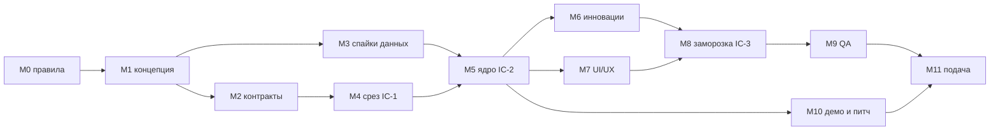

> **АРХИВ v1 (10.10.2026).** Документ заменён планом v2 и не является руководством к действию. Актуальные документы — см. [CLAUDE.md](../../../CLAUDE.md). Номера задач здесь относятся к старому реестру `tasks_v1.json` и в новом реестре не действуют.

# Мастер-план

Владелец: MEMBER_A. Время — по Астане (UTC+5). Статусы задач — только в `project/tasks.json` (`python3 tools/tasks.py status`). Разделы между `BEGIN/END GENERATED` создаёт `python3 tools/tasks.py render`.

## 1. Принципы

1. **До 14.11 09:00 — только подготовка:** учёба, аккаунты, окружение, вопросы организаторам, поддержка плана (CLAUDE.md §1).
2. **Сначала самое рискованное:** спайки данных (PLNT-01, EARTH-01, EARTH-02) — в первые часы, ворота решения — в 15:00 субботы.
3. **Сначала вертикальный срез, потом ширина:** к 17:30 субботы одна цель × один профиль на реальных данных на прод-ссылке (IC-1), затем все цели.
4. **Контракты и фикстуры к 11:30** — дальше все работают параллельно.
5. **Жёсткие заморозки:** функции — Вс 11:00, код — Вс 13:00, подача — минимум за 3 часа до дедлайна.
6. **Реалистичный бюджет:** на площадке ≈ 9 часов работы, плюс вечер 14.11 дома ≈ 3,5 часа и утро — всего ≈ 15 часов на человека до питча. P0+P1 = 66 человеко-часов из ≈ 90 доступных, запас ≈ 27 %.

## 2. Календарь

| Период | Фаза | Можно | Главное |
| --- | --- | --- | --- |
| 10.10–27.10 | Подготовка | Учёба, аккаунты, окружение, вопросы организаторам | PREP-01…PREP-13 |
| 28–29.10 | Полное условие | Разбор условия, правка плана | RULE-01 |
| 02.11–13.11 | Space Apps Connect | Вопросы экспертам, завершение тренировок | RULE-02 |
| 13.11 | Гайды 2026 | Сверка правил, проверка готовности | RULE-03, RULE-04 |
| 14.11 09:00 – 15.11 13:00 | Хакатон | Вся работа над проектом | KICK-01 → SUB-05 |
| 15.11 14:00–18:00 | Питч на площадке | Презентация, ответы жюри | STORY-06 |
| 15.11 18:00–21:00 | Глобальная подача | Доводка страницы и подача, если организаторы разрешают | SUB-06 |
| декабрь 2026 / январь 2027 | Итоги | | |

## 3. Подготовка по неделям

| Неделя | Цель недели | Задачи |
| --- | --- | --- |
| 10–16.10 | Все прочитали CLAUDE.md и свой MEMBER_X.md; письмо организаторам отправлено; доступы к GitHub и Discord | PREP-01, PREP-03, начало PREP-04, PREP-12 |
| 17–23.10 | Ответы организаторов; регистрация 6/6; аккаунты кодеров работают; тренировки идут | PREP-02, PREP-04, PREP-05…PREP-08, PREP-09 |
| 24–30.10 | 28.10 разбор полного условия и созвон; план обновлён | RULE-01, PREP-10 |
| 31.10–06.11 | Вопросы экспертам; тренировки закончены; окружение на 4 из 6 ноутбуков | RULE-02, PREP-11, PREP-12 |
| 07–13.11 | Окружение 6/6 к 08.11; логистика; 13.11 гайды и финальная проверка; выспаться | PREP-12, PREP-13, RULE-03, RULE-04 |

## 4. Вехи

| Веха | Когда | Критерий выхода | Ключевые задачи |
| --- | --- | --- | --- |
| M0 · Правила, условие, репозиторий | до 13.11 | Правила 2026 сверены, условие разобрано, аккаунты и окружение 6/6, ответы организаторов получены | PREP-*, RULE-* |
| M1 · Концепция зафиксирована | Сб 09:30 | Решения ACCEPTED, коммит пререгистрации, название | KICK-01, STORY-01 |
| M2 · Контракты и каркас | Сб 11:30 | `make check` работает, контракты v1 заморожены, фикстуры готовы | INFRA-01…INFRA-03 |
| M3 · Спайки данных | Сб 15:00 | Окна DEM Луны и Марса читаются (или выбран запасной уровень), сетка Земли построена, цели и эталоны в CSV | PLNT-01, EARTH-01, ENG-01, SCI-01, SCI-03 |
| M4 · Вертикальный срез | Сб 17:30, IC-1 | На прод-ссылке одна цель × один профиль на реальных данных | WEB-01…WEB-04, INFRA-05 |
| M5 · Научное ядро | Сб 22:30, IC-2 | Все P0-цели и признаки, results.json, validation.json, проверка геолога | EARTH-05, PLNT-03, ENG-03, ENG-05, SCI-05 |
| M6 · Инновационные функции | Вс 11:00 | Twin view, объяснения, ползунки (если успели), досье | WEB-05, ENG-07, WEB-06, SCI-06 |
| M7 · UI/UX | Вс 11:00 | Страница «Метод», тексты, адаптивность | WEB-07, STORY-02, WEB-11 |
| M8 · Интеграция и проверка | Вс 11:00, IC-3 | Заморозка функций, все P0 в DONE или сняты | INFRA-06, EARTH-07, ENG-06 |
| M9 · Надёжность и QA | Вс 12:30 | `make check` зелёный, тест на пользователе, офлайн-комплект | QA-01…QA-03 |
| M10 · Демо, история, питч | Вс 13:30 | Видео, слайды, репетиция | STORY-03…STORY-06 |
| M11 · Подача | Вс 13:30 или 21:00 | Ворота G1–G10 пройдены, проект подан | SUB-01…SUB-06, SCI-08 |

## 5. План часов хакатона

Окна совпадают с полем `window` в задачах. «Брифинг» 10:00–12:00 слушает MEMBER_F и пишет конспект в #general; остальные работают, если организаторы разрешили (PREP-01, вопрос 5).

**Суббота, 14.11**

| Время | MEMBER_A | MEMBER_B | MEMBER_C | MEMBER_D | MEMBER_E | MEMBER_F |
| --- | --- | --- | --- | --- | --- | --- |
| 09:00–09:30 | KICK-01 (ведёт) | KICK-01 | KICK-01 | KICK-01 | KICK-01 | KICK-01 |
| 09:30–10:15 | INFRA-01 | EARTH-01 | PLNT-01 | ENG-01 | SCI-01 → SCI-03 | STORY-01 |
| 10:15–11:00 | INFRA-02 | EARTH-01 | PLNT-01 | ENG-01 | SCI-03 | Брифинг, конспект |
| 11:00–12:00 | INFRA-03 → WEB-01 | EARTH-02 | PLNT-01 | ENG-02 | SCI-03 → SCI-04 | Брифинг, конспект |
| 12:00–13:00 | Обед и синхронизация № 1: блокеры | | | | | |
| 13:00–14:30 | WEB-01 | EARTH-02 + EARTH-03 (параллельно в GEE) | PLNT-01 → решение; PLNT-02 | ENG-02 → WEB-03 | SCI-04 → SCI-02 | STORY-03 |
| 14:30–15:30 | WEB-02 | EARTH-03 | PLNT-02 | WEB-03 | SCI-02 | STORY-03 → SUB-02 (черновик) |
| **15:00** | **Ворота данных** (§8) | | | | | |
| 15:30–16:30 | WEB-02 → INFRA-05 | EARTH-03 → EARTH-05 | PLNT-07 | WEB-04 | SCI-07 | SUB-02 (черновик) |
| 16:30–17:30 | INFRA-04 | EARTH-05 → EARTH-07 | PLNT-03 | WEB-04 → ENG-03 (срез) | помощь D с профилями | SUB-02 → STORY-02 (с 17:00) |
| **17:30** | **IC-1:** срез на прод-ссылке | | | | | |
| 18:00–19:30 | Дорога, ужин | | | | | |
| 19:30–21:00 | Слияние веток, правки | Правки по замечаниям | PLNT-04 | ENG-03 (полный) → ENG-05 | SCI-05 (с 20:00) | STORY-04 (черновик) |
| 21:00–22:30 | WEB-05 | EARTH-06 | ENG-06 | ENG-05 | SCI-06 | Отдых или помощь F→E с английским |
| **22:30** | **IC-2 и ворота объёма** (§8) | EARTH-08 | | ENG-07 → ENG-04 | SCI-06 | |
| 23:00–23:30 | Сон. Кто не закончил P1 — откладывает | | | | | |

**Воскресенье, 15.11**

| Время | MEMBER_A | MEMBER_B | MEMBER_C | MEMBER_D | MEMBER_E | MEMBER_F |
| --- | --- | --- | --- | --- | --- | --- |
| 09:00–10:00 | WEB-05 | SUB-03 | SUB-01 | WEB-07 | SCI-06 | STORY-04 (числа) → SUB-02 (числа) |
| 10:00–11:00 | WEB-11; запись экрана для видео (10:30) | SUB-03 → правки | SUB-01 → QA-02 | WEB-06 | SCI-09 | SUB-02 → STORY-05 |
| **11:00** | **Заморозка функций, IC-3** | | | | | |
| 11:00–12:00 | QA-03 | Правки данных | QA-02 → SUB-04 | QA-01, правки | SCI-08 | STORY-05 |
| 12:00–13:00 | SUB-05 | Правки | Помощь с README | Правки | SCI-08 | STORY-05 → STORY-06 |
| **13:00** | **Заморозка кода, тег v1.0** | | | | | |
| 13:00–14:00 | Обед, последняя проверка ссылок; SUB-06, если организаторы требуют подачу до питча | | | | | |
| 14:00–18:00 | Питч, судейство, награждение | | | | | |
| 18:00–21:00 | Доводка страницы и SUB-06, если подача ещё открыта | | | | | |

## 6. Критический путь

<!-- ARCHIVED GENERATED:critical-path -->
Самая длинная цепочка P0-задач хакатона по зависимостям: **12.75 ч** работы подряд (без учёта ожидания и перерывов). Любая задержка в ней сдвигает подачу.

| # | ID | Задача | Владелец | Ч | Накопительно | Окно |
| --- | --- | --- | --- | --- | --- | --- |
| 1 | KICK-01 | Старт 09:00: фиксация объёма и пререгистрация | MEMBER_A | 0.5 | 0.5 | Сб 09:00–09:30 |
| 2 | INFRA-01 | Каркас репозитория | MEMBER_A | 0.75 | 1.25 | Сб 09:30–10:15 |
| 3 | INFRA-02 | Контракты данных v1 | MEMBER_A | 1 | 2.25 | Сб 10:15–11:00 |
| 4 | EARTH-01 | Сетка кандидатов Земли | MEMBER_B | 1 | 3.25 | Сб 09:30–11:00 |
| 5 | EARTH-02 | Рельефные признаки Земли в GEE | MEMBER_B | 2.5 | 5.75 | Сб 11:00–14:30 |
| 6 | EARTH-05 | Экспорт earth_tiles.json | MEMBER_B | 1 | 6.75 | Сб 16:00–17:15 |
| 7 | ENG-03 | Пакетный расчёт results.json | MEMBER_D | 1 | 7.75 | Сб 17:15–17:45 срез · 19:30–20:00 полный |
| 8 | ENG-05 | Валидация: слепое восстановление известных пар | MEMBER_D | 2 | 9.75 | Сб 20:00–22:00 |
| 9 | SUB-02 | Тексты страницы проекта | MEMBER_F | 1.5 | 11.25 | Сб 15:00–17:00 черновик · Вс 09:45–10:30 числа |
| 10 | SCI-08 | Реестр утверждений и научная подпись | MEMBER_E | 1 | 12.25 | Вс 11:00–12:30 |
| 11 | SUB-06 | Финальная подача | MEMBER_F | 0.5 | 12.75 | Вс 13:15–13:30 или до 21:00 (по ответу на PREP-01) |

С учётом P1-задач самая длинная цепочка — 12.75 ч: KICK-01 → INFRA-01 → INFRA-02 → EARTH-01 → EARTH-02 → EARTH-05 → ENG-03 → ENG-05 → SUB-02 → SCI-08 → SUB-06.
<!-- ARCHIVED END:critical-path -->

Главные узкие места: спайк данных Луны и Марса (PLNT-01) и расчёт признаков Земли в GEE (EARTH-02). Они начинаются в 09:30 и имеют запасные варианты (RISK_REGISTER R03, R04).

## 7. Приоритеты: что отрезаем при отставании

Режем строго по порядку. P0 не режем никогда.

1. P3: WEB-10 (3D).
2. P2: WEB-12, WEB-09, PLNT-06, WEB-08, ENG-08, PLNT-05, EARTH-04.
3. WEB-06 и ENG-04 (живые ползунки) — остаётся переключение профилей.
4. ENG-07 (текстовые объяснения) — панель строит «совпадает / отличается» из d.
5. SCI-06: 3 досье → 1 досье.
6. EARTH-08 и ENG-06 (кросс-проверка DEM и чувствительность) — честно пишем как следующий шаг.
7. STORY-02 (тексты интерфейса) — минимальные подписи.
8. WEB-05 (Twin view) — держим до последнего: это WOW-момент; запасной вариант — пара картинок на слайде.
9. P1-цели (Arcadia, Meridiani, de Gerlache Rim 2) не добавляем.

Никогда не режем: валидацию (ENG-05), страницу «Метод» (WEB-07), ограничения (SCI-07), научную подпись (SCI-08), задачи подачи (SUB-*), запасной комплект демо (QA-03).

## 8. Ворота решений

| Когда | Кто решает | Вопрос | Если «нет» |
| --- | --- | --- | --- |
| Сб 13:30, крайний срок 15:00 | MEMBER_C с A | Читаются окна DEM 200 м для Луны и Марса? | Лестница данных: уровень 2 → 3 → 4 (SCIENTIFIC_METHODOLOGY §3.5); B пересчитывает Землю на то же разрешение |
| Сб 15:00 | MEMBER_B с A | Идут ли расчёты GEE для всех регионов? | Сократить глобальную выборку до 1000 квадратов; если GEE недоступен — Planetary Computer или Copernicus DEM на AWS для Казахстана и эталонов |
| Сб 22:30 (IC-2) | MEMBER_A с командой | Готовы ли все P0-данные и валидация? | Egiz Lite: 3 цели Марса + 1 Луны, без ползунков; режем по §7; план на утро в #general |
| Вс 11:00 (IC-3) | MEMBER_A | Заморозка функций | Только исправления, тексты, демо |
| Вс 13:00 | MEMBER_A | Заморозка кода, тег v1.0 | После — только README и страница проекта |

## 9. Контингенты

Полный реестр — [RISK_REGISTER](RISK_REGISTER.md). Коротко: нет интернета на площадке → две точки доступа и офлайн-сборка; заболел участник → его задачи берёт пара (A↔D сайт, B↔C данные, E↔F тексты), документы позволяют продолжить через Claude Code; провалилась валидация → публикуем честно, разбираем провалы по типам аналогов.

## 10. Структура работ (WBS)

<!-- ARCHIVED GENERATED:wbs -->
#### M0 · Правила, условие и репозиторий (до 13.11) — 17 задач, 29.5 ч

| ID | Задача | Владелец | P | Ч | Зависит от | Окно | Флаги |
| --- | --- | --- | --- | --- | --- | --- | --- |
| PREP-01 | Вопросы организаторам площадки Astana | MEMBER_F | P0 | 0.5 | — | до 20.10 | — |
| PREP-02 | Регистрация команды и профилей на spaceappschallenge.org | MEMBER_F | P0 | 0.5 | — | до 27.10 | — |
| PREP-03 | GitHub, Discord и приватность в git | MEMBER_A | P0 | 1 | — | до 20.10 | — |
| PREP-04 | Аккаунты кодеров: Earthdata, Earth Engine, Vercel | MEMBER_A | P0 | 1 | — | до 27.10 | — |
| PREP-12 | Окружение на всех ноутбуках | MEMBER_A | P0 | 1.5 | — | до 08.11 | — |
| RULE-01 | 28.10: разбор полного условия челленджа | MEMBER_A | P0 | 1.5 | — | 28–29.10 | — |
| RULE-03 | 13.11: гайды подачи и судейства 2026 | MEMBER_F | P0 | 1 | — | 13.11 | — |
| RULE-04 | 13.11 вечер: финальная проверка готовности | MEMBER_A | P0 | 0.5 | RULE-01, RULE-03, PREP-02, PREP-04, PREP-12 | 13.11 вечер | — |
| PREP-05 | Тренировка Earth Engine на постороннем районе | MEMBER_B | P1 | 3 | PREP-04 | до 08.11 | — |
| PREP-06 | Тренировка: rasterio и GDAL, окна удалённых COG, проекции тел | MEMBER_C | P1 | 3 | — | до 08.11 | — |
| PREP-07 | Тренировка: numpy, pandas, pytest, Vitest, ранговые метрики | MEMBER_D | P1 | 3 | — | до 08.11 | — |
| PREP-08 | Тренировка: Vite + React + TypeScript + MapLibre, деплой | MEMBER_A | P1 | 3 | PREP-04 | до 08.11 | — |
| PREP-09 | Чтение: аналоги, Moon Base, места посадки, геология Казахстана | MEMBER_E | P1 | 5 | — | до 08.11 | — |
| PREP-10 | Разбор демо победителей и инструментов монтажа | MEMBER_F | P1 | 2 | — | до 08.11 | — |
| PREP-13 | Логистика дня хакатона | MEMBER_F | P1 | 0.5 | — | до 12.11 | — |
| RULE-02 | Space Apps Connect: вопросы экспертам | MEMBER_F | P1 | 1 | RULE-01 | 02–13.11 | — |
| PREP-11 | Мини-тренировка команды: Git и Claude Code | MEMBER_A | P2 | 1.5 | PREP-03 | до 08.11 | OPTIONAL |

#### M1 · Концепция и объём зафиксированы (Сб 09:00–09:30) — 2 задач, 1.25 ч

| ID | Задача | Владелец | P | Ч | Зависит от | Окно | Флаги |
| --- | --- | --- | --- | --- | --- | --- | --- |
| KICK-01 | Старт 09:00: фиксация объёма и пререгистрация | MEMBER_A | P0 | 0.5 | RULE-04 | Сб 09:00–09:30 | CRITICAL_PATH |
| STORY-01 | Название, слоган, ценностное предложение | MEMBER_F | P0 | 0.75 | KICK-01 | Сб 09:30–10:00 | — |

#### M2 · Контракты и каркас (Сб 09:30–11:30) — 3 задач, 2.25 ч

| ID | Задача | Владелец | P | Ч | Зависит от | Окно | Флаги |
| --- | --- | --- | --- | --- | --- | --- | --- |
| INFRA-01 | Каркас репозитория | MEMBER_A | P0 | 0.75 | KICK-01 | Сб 09:30–10:15 | CRITICAL_PATH |
| INFRA-02 | Контракты данных v1 | MEMBER_A | P0 | 1 | INFRA-01 | Сб 10:15–11:00 | CRITICAL_PATH |
| INFRA-03 | Синтетические фикстуры по контракту | MEMBER_A | P0 | 0.5 | INFRA-02 | Сб 11:00–11:30 | CRITICAL_PATH, PARALLELIZABLE |

#### M3 · Спайки критических данных (Сб 09:30–15:00, ворота 15:00) — 5 задач, 6 ч

| ID | Задача | Владелец | P | Ч | Зависит от | Окно | Флаги |
| --- | --- | --- | --- | --- | --- | --- | --- |
| EARTH-01 | Сетка кандидатов Земли | MEMBER_B | P0 | 1 | INFRA-02 | Сб 09:30–11:00 | CRITICAL_PATH, HIGH_RISK |
| ENG-01 | terrain_metrics(): одна функция для трёх тел | MEMBER_D | P0 | 1 | INFRA-01 | Сб 09:30–11:00 | CRITICAL_PATH |
| PLNT-01 | Спайк доступа к DEM Луны и Марса | MEMBER_C | P0 | 2 | KICK-01 | Сб 09:30–13:30, решение до 15:00 | CRITICAL_PATH, HIGH_RISK |
| SCI-01 | Список целей и координаты | MEMBER_E | P0 | 0.5 | KICK-01 | Сб 09:30–10:00 | CRITICAL_PATH |
| SCI-03 | Эталонные пары и пререгистрированное разбиение | MEMBER_E | P0 | 1.5 | KICK-01 | Сб 10:00–11:30 | CRITICAL_PATH |

#### M4 · Сквозной срез на реальных данных (Сб 17:30, IC-1) — 4 задач, 5.75 ч

| ID | Задача | Владелец | P | Ч | Зависит от | Окно | Флаги |
| --- | --- | --- | --- | --- | --- | --- | --- |
| WEB-01 | Каркас приложения и загрузка данных | MEMBER_A | P0 | 1.5 | INFRA-03 | Сб 11:30–14:30 | CRITICAL_PATH |
| WEB-02 | Карта Земли: подложка NASA GIBS и раскраска квадратов | MEMBER_A | P0 | 1.5 | WEB-01 | Сб 14:30–16:00 | — |
| WEB-03 | Выбор цели и задачи, рейтинг | MEMBER_D | P0 | 1.5 | WEB-01 | Сб 13:30–15:30 | — |
| WEB-04 | Панель объяснения кандидата | MEMBER_D | P0 | 1.25 | WEB-03 | Сб 15:30–17:15 | — |

#### M5 · Научное ядро (Сб 22:30, IC-2) — 12 задач, 17.75 ч

| ID | Задача | Владелец | P | Ч | Зависит от | Окно | Флаги |
| --- | --- | --- | --- | --- | --- | --- | --- |
| EARTH-02 | Рельефные признаки Земли в GEE | MEMBER_B | P0 | 2.5 | EARTH-01, ENG-01 | Сб 11:00–14:30 | CRITICAL_PATH, HIGH_RISK |
| EARTH-03 | Признаки среды Земли в GEE | MEMBER_B | P0 | 2 | EARTH-01 | Сб 13:00–16:00 (параллельно с расчётами EARTH-02 в GEE) | PARALLELIZABLE |
| EARTH-05 | Экспорт earth_tiles.json | MEMBER_B | P0 | 1 | EARTH-02, EARTH-03, SCI-03 | Сб 16:00–17:15 | CRITICAL_PATH |
| ENG-02 | Ядро скоринга (Python) | MEMBER_D | P0 | 1.5 | INFRA-02 | Сб 11:00–13:30 | — |
| ENG-03 | Пакетный расчёт results.json | MEMBER_D | P0 | 1 | ENG-02, EARTH-05, PLNT-03, SCI-04 | Сб 17:15–17:45 срез · 19:30–20:00 полный | CRITICAL_PATH |
| ENG-05 | Валидация: слепое восстановление известных пар | MEMBER_D | P0 | 2 | ENG-03, SCI-03, SCI-04, KICK-01 | Сб 20:00–22:00 | CRITICAL_PATH |
| PLNT-02 | Окна целей и рельефные признаки | MEMBER_C | P0 | 2 | PLNT-01, ENG-01, SCI-01 | Сб 13:30–15:30 | CRITICAL_PATH |
| PLNT-03 | targets.json по контракту | MEMBER_C | P0 | 0.75 | PLNT-02, SCI-02 | Сб 16:30–17:15 | CRITICAL_PATH |
| SCI-02 | Среда и геология целей со ссылками | MEMBER_E | P0 | 2 | SCI-01 | Сб 13:30–15:30 | — |
| SCI-04 | Профили задач, веса и шаги | MEMBER_E | P0 | 1 | KICK-01 | Сб 11:30–12:00 и 13:00–13:30 | — |
| SCI-05 | Научная проверка топ-кандидатов | MEMBER_E | P0 | 1 | ENG-03 | Сб 20:00–21:00 | — |
| PLNT-07 | Общая функция освещённости low_sun_frac | MEMBER_C | P1 | 1 | INFRA-01 | Сб 15:30–16:30 | PARALLELIZABLE |

#### M6 · Инновационные функции (Вс 11:00) — 15 задач, 18.5 ч

| ID | Задача | Владелец | P | Ч | Зависит от | Окно | Флаги |
| --- | --- | --- | --- | --- | --- | --- | --- |
| SCI-07 | Ограничения: чего не воспроизводит Земля | MEMBER_E | P0 | 0.75 | SCI-02 | Сб 15:30–16:15 | — |
| EARTH-06 | DEM-окна Земли для Twin view | MEMBER_B | P1 | 1.5 | ENG-03, PLNT-04 | Сб 21:00–22:30 | — |
| ENG-04 | Скоринг в браузере и golden-тест | MEMBER_D | P1 | 1 | ENG-02, WEB-01 | Сб 22:45–23:30 (если остаётся время) | — |
| ENG-07 | Объяснения по шаблонам, без LLM | MEMBER_D | P1 | 0.75 | ENG-03 | Сб 22:00–22:45 | — |
| PLNT-04 | Функция отрисовки и картинки целей для Twin view | MEMBER_C | P1 | 1.5 | PLNT-02 | Сб 19:30–21:00 | — |
| SCI-06 | Досье казахстанских кандидатов | MEMBER_E | P1 | 2.5 | SCI-05 | Сб 21:00–23:00 · Вс 09:00–10:00 | — |
| WEB-05 | Twin view | MEMBER_A | P1 | 2 | WEB-02, PLNT-04, EARTH-06 | Сб 21:00–23:00 · Вс 09:00–10:00 | — |
| WEB-06 | Ползунки весов | MEMBER_D | P1 | 0.75 | ENG-04, WEB-03 | Вс 10:00–10:45 (если готова ENG-04) | — |
| EARTH-04 | Логистика квадратов (только справка) | MEMBER_B | P2 | 0.75 | EARTH-01 | — | OPTIONAL |
| ENG-08 | Многомасштабная шероховатость | MEMBER_D | P2 | 1 | ENG-01 | — | OPTIONAL |
| PLNT-06 | Картинки «пробелов аналогов» | MEMBER_C | P2 | 1 | ENG-03 | — | OPTIONAL |
| WEB-08 | Досье Казахстана в интерфейсе | MEMBER_A | P2 | 1 | SCI-06, WEB-04 | — | OPTIONAL |
| WEB-09 | Экран «пробелы аналогов» | MEMBER_A | P2 | 1 | PLNT-06 | — | OPTIONAL |
| WEB-12 | Режим низкого Солнца в Twin view | MEMBER_A | P2 | 1 | WEB-05, PLNT-04 | — | OPTIONAL |
| WEB-10 | 3D-двойники (three.js) | MEMBER_A | P3 | 2 | WEB-05 | — | OPTIONAL |

#### M7 · UI/UX и визуализация (Вс 11:00) — 3 задач, 2.75 ч

| ID | Задача | Владелец | P | Ч | Зависит от | Окно | Флаги |
| --- | --- | --- | --- | --- | --- | --- | --- |
| WEB-07 | Страница «Метод и проверка» | MEMBER_D | P0 | 1 | ENG-05, SCI-07 | Вс 09:00–10:00 | — |
| STORY-02 | Тексты интерфейса | MEMBER_F | P1 | 1 | WEB-01, STORY-01 | Сб 17:00–18:00 | — |
| WEB-11 | Адаптивность, доступность, скорость | MEMBER_A | P1 | 0.75 | WEB-04 | Вс 10:00–11:00 | — |

#### M8 · Интеграция и проверка (Вс 11:00, IC-3, заморозка функций) — 6 задач, 5.25 ч

| ID | Задача | Владелец | P | Ч | Зависит от | Окно | Флаги |
| --- | --- | --- | --- | --- | --- | --- | --- |
| EARTH-07 | Проверки здравого смысла по Земле | MEMBER_B | P0 | 0.5 | EARTH-05 | Сб 17:15–17:45 | — |
| INFRA-05 | Деплой и запасной хостинг | MEMBER_A | P0 | 0.75 | WEB-01 | Сб 16:00–16:45 | — |
| INFRA-06 | Точки интеграции IC-1, IC-2, IC-3 | MEMBER_A | P0 | 1.5 | INFRA-05 | Сб 17:30 · Сб 22:30 · Вс 11:00 | — |
| EARTH-08 | Перекрёстная проверка DEM: Copernicus и NASADEM | MEMBER_B | P1 | 0.75 | EARTH-02 | Сб 22:30–23:15 | — |
| ENG-06 | Чувствительность к весам и шагам | MEMBER_C | P1 | 1 | ENG-03 | Сб 21:00–22:00 | — |
| PLNT-05 | Влияние масштаба: 200 и 400 м | MEMBER_C | P2 | 0.75 | PLNT-02 | — | OPTIONAL |

#### M9 · Надёжность и QA (Вс 11:00–12:30) — 4 задач, 2.25 ч

| ID | Задача | Владелец | P | Ч | Зависит от | Окно | Флаги |
| --- | --- | --- | --- | --- | --- | --- | --- |
| QA-01 | Автопроверки зелёные | MEMBER_D | P0 | 0.5 | ENG-03, WEB-04 | Вс 11:00–11:30 | — |
| QA-03 | Запасной комплект демо | MEMBER_A | P0 | 0.5 | WEB-04 | Вс 11:30–12:00 | — |
| INFRA-04 | CI в GitHub Actions | MEMBER_A | P1 | 0.5 | INFRA-01 | Сб 16:45–17:15 | — |
| QA-02 | Тест на свежем пользователе | MEMBER_C | P1 | 0.75 | WEB-04 | Вс 10:30–11:15 | — |

#### M10 · Демо, история, питч (Вс 09:00–13:30) — 5 задач, 6.5 ч

| ID | Задача | Владелец | P | Ч | Зависит от | Окно | Флаги |
| --- | --- | --- | --- | --- | --- | --- | --- |
| STORY-03 | Раскадровка и сценарий 30-секундного видео | MEMBER_F | P0 | 1 | STORY-01 | Сб 13:00–15:00 черновик · Вс 09:00 числа | — |
| STORY-04 | 7 слайдов: запасное демо и питч | MEMBER_F | P0 | 1.5 | ENG-05, STORY-01 | Сб 19:30–21:00 черновик · Вс 09:00–09:45 числа | — |
| STORY-05 | Запись, монтаж и публикация видео | MEMBER_F | P0 | 2 | STORY-03, WEB-04 | Вс 10:30–12:30 | — |
| STORY-06 | Репетиция питча | MEMBER_F | P0 | 1 | STORY-04 | Вс 12:30–13:15 | — |
| SCI-09 | Ответы на трудные вопросы жюри | MEMBER_E | P1 | 1 | ENG-05 | Вс 10:00–10:45 | — |

#### M11 · Подача и соответствие правилам (Вс 13:30 или 21:00) — 7 задач, 6.25 ч

| ID | Задача | Владелец | P | Ч | Зависит от | Окно | Флаги |
| --- | --- | --- | --- | --- | --- | --- | --- |
| SCI-08 | Реестр утверждений и научная подпись | MEMBER_E | P0 | 1 | ENG-05, SUB-02, STORY-04 | Вс 11:00–12:30 | — |
| SUB-01 | README для жюри | MEMBER_C | P0 | 1 | ENG-05 | Вс 09:00–10:30 | — |
| SUB-02 | Тексты страницы проекта | MEMBER_F | P0 | 1.5 | ENG-05, STORY-01 | Сб 15:00–17:00 черновик · Вс 09:45–10:30 числа | — |
| SUB-03 | Реестр источников и лицензий | MEMBER_B | P0 | 1 | EARTH-05, PLNT-03, WEB-01 | Вс 09:00–10:30 | — |
| SUB-04 | Раскрытие использования ИИ | MEMBER_C | P0 | 0.5 | SUB-02, STORY-05 | Вс 11:30–12:00 | — |
| SUB-05 | Приватность и публикация репозитория | MEMBER_A | P0 | 0.75 | SUB-01 | Вс 12:00–13:00 | — |
| SUB-06 | Финальная подача | MEMBER_F | P0 | 0.5 | SUB-02, SUB-03, SUB-04, SUB-05, STORY-05, SCI-08 | Вс 13:15–13:30 или до 21:00 (по ответу на PREP-01) | — |
<!-- ARCHIVED END:wbs -->
