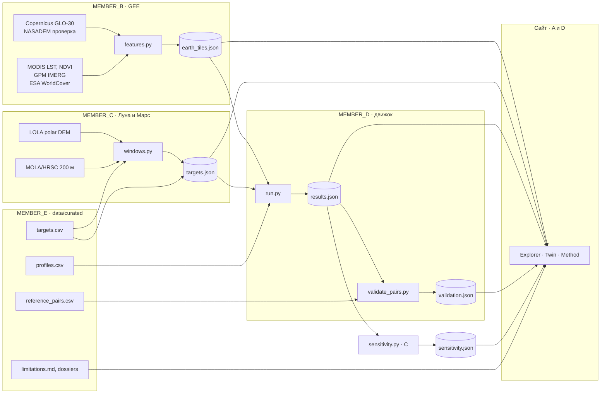

> **АРХИВ v1 (10.10.2026).** Документ заменён планом v2 и не является руководством к действию. Актуальные документы — см. [CLAUDE.md](../../../CLAUDE.md). Номера задач здесь относятся к старому реестру `tasks_v1.json` и в новом реестре не действуют.

# Архитектура системы

Владелец документа: MEMBER_A. Статус: план (DEC-011, PROPOSED → ACCEPTED на KICK-01). Код по этому плану пишем только с 14.11 09:00.

## 1. Обзор и принципы

Узкие места хакатона — правильность данных и сборка в последний час, а не объём кода: код быстро пишется с ИИ. Архитектура оптимизирует надёжность, научную точность, скорость разработки и эффект на демо.

1. **Всё тяжёлое считаем заранее.** Python-конвейер выдаёт маленькие JSON. Сайт статический, сервера нет — демо не упадёт из-за бэкенда.
2. **Контракты до кода.** В первые два часа замораживаем схемы JSON (v1) и делаем фикстуры по ним. Пока считаются настоящие данные, сайт и движок работают на фикстурах.
3. **Одна линейка.** Одна функция рельефа для трёх тел, одно разрешение, одна функция отрисовки картинок.
4. **Чёткое владение.** У каждого файла один владелец (раздел `ownership` в `project/tasks.json`). Общие интерфейсы меняются только по протоколу.
5. **Честные данные.** Синтетика помечена (`synthetic: true`, id с `FAKE_`, плашка в интерфейсе) и не попадает в `data/processed/`.

## 2. Компоненты и владельцы

| Компонент | Владелец | Вход | Выход | Задачи |
| --- | --- | --- | --- | --- |
| Курируемые научные данные | MEMBER_E | Литература, источники NASA, USGS, LROC | `data/curated/*.csv`, `limitations.md`, `dossiers/` | SCI-01…SCI-07 |
| Контракты и фикстуры | MEMBER_A | Этот документ | `contracts/*.schema.json`, `web/src/types.ts`, `data/fixtures/` | INFRA-02, INFRA-03 |
| Конвейер Земли | MEMBER_B | GEE: Copernicus GLO-30, MODIS, GPM IMERG, WorldCover | `data/processed/earth_tiles.json`, `web/public/img/earth/` | EARTH-01…EARTH-08 |
| Конвейер Луны и Марса | MEMBER_C | LOLA, MOLA/HRSC, `targets.csv` | `data/processed/targets.json`, `web/public/img/targets/` | PLNT-01…PLNT-07 |
| Общие функции | D: `terrain.py`; C: `illumination.py`, `render.py` | Массивы DEM, широта | Признаки, картинки | ENG-01, PLNT-07, PLNT-04 |
| Движок и валидация | MEMBER_D (чувствительность — MEMBER_C) | earth_tiles, targets, profiles, reference_pairs | `results.json`, `validation.json`, `sensitivity.json`, графики | ENG-02…ENG-07 |
| Сайт: каркас, карта, Twin view, деплой | MEMBER_A | `/data/*.json`, картинки | Статический сайт | WEB-01, WEB-02, WEB-05, INFRA-05 |
| Сайт: рейтинг, объяснение, веса, «Метод» | MEMBER_D | store, `scoring.ts` | Компоненты | WEB-03, WEB-04, WEB-06, WEB-07 |
| Тексты интерфейса | MEMBER_F | brand | `web/src/content/copy.json` | STORY-02 |

## 3. Поток данных



Порядок запуска: `pipeline.earth.*` (B) и `pipeline.planets.*` (C) параллельно → `pipeline.engine.run` → `pipeline.engine.validate_pairs` и `pipeline.engine.sensitivity` → сборка сайта (prebuild копирует `data/processed/*.json` в `web/public/data/`).

## 4. Контракты данных v1

Общие поля каждого файла:

| Поле | Тип | Смысл |
| --- | --- | --- |
| `schema` | string | `egiz.earth_tiles`, `egiz.targets`, `egiz.profiles`, `egiz.results`, `egiz.validation`, `egiz.sensitivity` |
| `version` | string | семантическая версия схемы, старт `1.0.0`; сайт проверяет major |
| `generated_at` | string | ISO 8601 UTC |
| `synthetic` | bool | `true` только у фикстур; сайт показывает плашку |
| `provenance` | array | `{dataset, provider, version, url, role}` для каждого использованного набора |

Ключи признаков одинаковы для всех тел: `slope_p50_deg`, `slope_p90_deg`, `frac_slope_lt15`, `relief_m`, `roughness_m`, `elev_min_m`, `t_min_c`, `t_max_c`, `precip_mm`, `bare_frac`, `ndvi_max`, `low_sun_frac`. Пропуск — `null` и ключ в `missing`. Определения — [SCIENTIFIC_METHODOLOGY §3](../science/SCIENTIFIC_METHODOLOGY.md).

### 4.1 `earth_tiles.json` (владелец B)

```jsonc
{
  "schema": "egiz.earth_tiles", "version": "1.0.0", "generated_at": "2026-11-14T12:00:00Z",
  "synthetic": false, "res_m": 200, "tile_km": 20,
  "provenance": [{"dataset": "COPERNICUS/DEM/GLO30", "provider": "ESA", "version": "GLO-30", "url": "https://developers.google.com/earth-engine/datasets/catalog/COPERNICUS_DEM_GLO30", "role": "terrain"}],
  "tiles": [{
    "id": "KZ_E051.20_N43.40",            // регион + центр
    "region": "kazakhstan",               // kazakhstan | global_sample | reference
    "ref_site": null,                     // для region=reference — ключ места, напр. "DEATH_VALLEY"
    "lon": 51.20, "lat": 43.40,           // центр квадрата, WGS84
    "bbox": [51.075, 43.31, 51.325, 43.49],
    "features": {"slope_p50_deg": 1.2, "slope_p90_deg": 4.8, "frac_slope_lt15": 0.98, "relief_m": 85,
                 "roughness_m": 2.1, "elev_min_m": -24, "t_min_c": -18.5, "t_max_c": 62.0,
                 "precip_mm": 140, "bare_frac": 0.82, "ndvi_max": 0.11, "low_sun_frac": 0.07},
    "context": {"tree_frac": 0.0, "crop_frac": 0.0, "built_frac": 0.0, "water_frac": 0.01, "snow_frac": 0.0, "elev_mean_m": 12},
    "missing": []
  }]
}
```

Числа в примерах выдуманы для иллюстрации формата.

### 4.2 `targets.json` (владелец C)

```jsonc
{
  "schema": "egiz.targets", "version": "1.0.0", "generated_at": "…", "synthetic": false,
  "res_m": 200, "tile_km": 20, "provenance": […],
  "targets": [{
    "id": "MARS_JEZERO", "body": "mars", "name_en": "Jezero crater",
    "kind": "landing_site",               // base_region | landing_site | exploration_zone | validation_only
    "lon": 77.45, "lat": 18.44,           // планетоцентрические, восточная долгота −180…180
    "profiles": ["ROVER", "EVA_GEOLOGY"],
    "features": {"slope_p50_deg": 2.4, "…": "…", "precip_mm": 0, "bare_frac": 1.0, "ndvi_max": 0.0},
    "feature_sources": {"slope_p50_deg": "computed:MOLA-HRSC-200m", "t_min_c": "SRC_MCD"},
    "lithology": ["basalt", "carbonate", "phyllosilicate_clay"], "lithology_sources": ["SRC_…"],
    "flags": {"ice": false, "salt": false},
    "image": "img/targets/MARS_JEZERO.png"
  }]
}
```

### 4.3 `profiles.json` (собирает D из `data/curated/profiles.csv` от E)

```jsonc
{
  "schema": "egiz.profiles", "version": "1.0.0", "generated_at": "…", "synthetic": false, "provenance": [],
  "clip_d": 3.0, "min_bare_frac": 0.5, "max_missing_weight_frac": 0.3,
  "features": {"slope_p50_deg": {"label_en": "Median slope", "unit": "deg", "step": 2.0, "kind": "terrain", "description_en": "…"}},
  "profiles": [{"id": "ROVER", "label_en": "Rover traverse test", "description_en": "…", "weights": {"slope_p50_deg": 3, "slope_p90_deg": 3}}]
}
```

### 4.4 `results.json` (владелец D)

```jsonc
{
  "schema": "egiz.results", "version": "1.0.0", "generated_at": "…", "synthetic": false, "provenance": [],
  "engine_version": "1.0.0",
  "inputs": {"earth_tiles_sha256": "…", "targets_sha256": "…", "profiles_sha256": "…"},
  "runs": [{
    "target": "MARS_JEZERO", "profile": "ROVER",
    "n_ranked": 9120, "n_excluded": {"filter": 3410, "incomplete": 85},
    "gaps": ["t_min_c"],                  // неустранимые разрывы для этой цели
    "best_kz": {"tile": "KZ_…", "rank": 37, "score": 71.4},
    "top": [{"tile": "GL_…", "rank": 1, "score": 88.2, "top_pct": 0.01,
             "d": {"slope_p50_deg": 0.3}, "contrib": {"slope_p50_deg": 0.004},
             "explain": {"matches": ["…"], "differences": ["…"]}}],
    "scores": [71.4, null, 12.9]          // по порядку earth_tiles.tiles, null = исключён; для раскраски карты
  }]
}
```

`runs` содержит все цели × все 4 профиля (у цели поле `profiles` — только рекомендация для интерфейса). `scores` хранится массивом без ключей, чтобы файл оставался маленьким: 24 прогона × ~10 000 квадратов ≈ 1–1,5 МБ.

### 4.5 `validation.json` (владелец D)

```jsonc
{
  "schema": "egiz.validation", "version": "1.0.0", "generated_at": "…", "synthetic": false, "provenance": [],
  "preregistration_commit": "abc1234", "split_rule": "sha256(pair_id + 'egiz2026') чётный → test",
  "pairs": [{"pair_id": "DEATH_VALLEY__MARS_UTOPIA_VL2", "earth_site": "DEATH_VALLEY", "ref_tile": "REF_DEATH_VALLEY",
             "target": "MARS_UTOPIA_VL2", "profile": "ROVER", "analog_type": "terrain", "testable": true,
             "exclusion_reason": null, "split": "test", "rank": 41, "n": 9120, "top_pct": 0.45,
             "hit_top10": true, "excluded_by_filter": false, "source": "SRC_NASA_PAE"}],
  "summary": {"n_test": 8, "hits_top10": 5, "binomial_p": 0.0004, "median_top_pct_test": 6.1,
              "random_expectation_pct": 50, "success_h1": true},
  "baselines": [{"name": "slope_p50_only", "hits_top10": 2, "median_top_pct_test": 31.0}],
  "negative_controls": {"tree_frac>0.5": 78.2, "crop_frac>0.5": 71.5, "built_frac>0.5": 69.9},
  "cross_checks": [{"name": "gee_vs_python_slope_p50", "metric": "max_abs_diff_deg", "value": 0.3, "tolerance": 0.5, "passed": true}],
  "figures": ["figures/validation_top_pct.svg"]
}
```

### 4.6 `sensitivity.json` (владелец C)

```jsonc
{
  "schema": "egiz.sensitivity", "version": "1.0.0", "generated_at": "…", "synthetic": false, "provenance": [],
  "draws": 200, "seed": 2026, "weight_range": [0.8, 1.2], "step_range": [0.5, 1.5],
  "runs": [{"target": "MARS_JEZERO", "profile": "ROVER", "tau_top20_median": 0.84, "tau_top20_iqr": [0.78, 0.89], "leader_stability": 0.91}],
  "summary_en": "…"
}
```

### 4.7 Курируемые CSV (владелец E)

| Файл | Колонки |
| --- | --- |
| `data/curated/targets.csv` | `id, body, name_en, kind, lat, lon, priority, profiles, coord_source, t_min_c, t_min_range, t_max_c, t_max_range, temp_source, ice_flag, salt_flag, lithology, lithology_source, notes` |
| `data/curated/reference_pairs.csv` | `pair_id, earth_site, lat, lon, target_id, profile, analog_type, testable, exclusion_reason, split, source` |
| `data/curated/profiles.csv` | `feature, step, step_rationale, ROVER, EVA_GEOLOGY, ISRU, LANDING_LOWSUN` + строки `clip_d`, `min_bare_frac` |
| `data/curated/sources.csv` | `key, citation, url_or_doi, accessed` |

Списки внутри ячейки разделяем `;`. Кодировка UTF-8, разделитель запятая.

## 5. Движок

```text
для каждой цели T и каждого профиля P:
    для каждого квадрата e:
        если e.bare_frac < min_bare_frac → исключён (filter)
        A = признаки с весом > 0, известные и у T, и у e
        если вес пропущенных признаков / общий вес > max_missing_weight_frac → исключён (incomplete)
        d_i = (e_i − T_i) / step_i;  d̃_i = sign(d_i)·min(|d_i|, clip_d)
        score = 100·exp(−Σ_A w_i·d̃_i² / Σ_A w_i);  contrib_i = w_i·d̃_i² / Σ_A w_i
    ранжировать по score; top_pct = 100·rank / n_ranked
    gaps = {i : min_e |d_i| ≥ clip_d}
    записать топ-50 с d, contrib, explain; scores всех; лучший KZ_
```

Тот же расчёт повторён в `web/src/lib/scoring.ts` для ползунков (ENG-04) и сверяется golden-тестом с точностью 1e-6.

## 6. Картинки Twin view

Одна функция `pipeline/common/render.py` (MEMBER_C) для целей и для Земли:

| Параметр | Значение |
| --- | --- |
| Размер | 512×512 PNG, окно 20×20 км с центром в цели или квадрате |
| Основа | отмывка рельефа: азимут 315°, высота Солнца 45° (вариант низкого Солнца: 1,5°) |
| Цвет | уклон 0–30°, палитра `cividis` (различима при дальтонизме), прозрачность 60 % поверх отмывки |
| Подписи | только масштабная линейка 5 км в левом нижнем углу |
| Имена файлов | `img/targets/{target_id}.png`, `img/earth/{tile_id}.png` |
| Манифест | `manifest.json`: `{id: {file, res_m, extent_km, colormap, slope_range_deg, sun_elev_deg}}` |

## 7. Веб-приложение

**Экраны.** Explorer (выбор цели и задачи, карта Земли, рейтинг, объяснение) · Twin (цель и кандидат рядом) · Method (метод, валидация, ограничения, источники, ИИ). Необязательные: Gap (пробелы аналогов), Dossiers (Казахстан).

**Компоненты и владельцы.** `components/layout/`, `components/map/`, `components/twin/`, `pages/TwinPage.tsx` — A; `components/ranking/`, `components/explain/`, `components/weights/`, `pages/MethodPage.tsx`, `lib/scoring.ts` — D; `content/copy.json` — F.

**Состояние** (один store, Zustand):

```ts
interface AppState {
  data: { earthTiles; targets; profiles; results; validation?; sensitivity? };
  targetId: string; profileId: string; selectedTileId: string | null;
  weights: Record<string, number> | null;          // null → веса профиля
  setTarget(id: string): void; setProfile(id: string): void;
  selectTile(id: string | null): void; setWeights(w: Record<string, number> | null): void;
}
```

**Загрузка.** При старте `fetch('/data/{earth_tiles,targets,profiles,results,validation,sensitivity}.json')`; проверка `schema` и major-версии; при `synthetic: true` хотя бы в одном файле — плашка «SYNTHETIC DEMO DATA — not NASA observations». Оценки для карты: из `results.runs[].scores` (P0) или живой расчёт `scoring.ts` при своих весах (P1).

**Карта.** MapLibre GL JS, растровая подложка NASA GIBS (EPSG:3857, URL взять из [документации GIBS](https://nasa-gibs.github.io/gibs-api-docs/)), квадраты — GeoJSON-полигоны из `bbox`, цвет через feature-state или `setData`. Без интернета — однотонный фон. Луна и Марс в MVP показываются картинками (полюс Луны в Web Mercator не отображается).

## 8. Деплой, запасной хостинг, офлайн

| Вариант | Как | Когда |
| --- | --- | --- |
| Основной: Vercel | `vercel.json` в корне: `buildCommand: "npm --prefix web ci && npm --prefix web run build"`, `outputDirectory: "web/dist"`; `prebuild` в `web/package.json` запускает `scripts/copy-data.mjs` | С INFRA-05; превью на каждый PR |
| Запасной: GitHub Pages | Workflow сборки и публикации из `main` | Только после того, как репозиторий стал публичным (SUB-05) |
| Офлайн | `npm --prefix web run build` → `npx serve web/dist`, архив `dist.zip` на двух ноутбуках | QA-03, для питча без интернета |

## 9. Структура репозитория

Сейчас в репозитории только документы, `project/` и `tools/`. Остальное создаётся с 14.11 09:00 (INFRA-01 и задачи владельцев).

```text
.
├── CLAUDE.md                 инструкции для агентов
├── README.md                 сейчас — для команды; к подаче — для жюри на английском (SUB-01)
├── LICENSE                   MIT (INFRA-01)
├── Makefile, pyproject.toml, requirements.txt, vercel.json
├── .claude/commands/         команды Claude Code
├── project/tasks.json        реестр задач
├── tools/tasks.py            проверка и вывод реестра
├── docs/                     документы команды
├── contracts/                JSON Schema v1 + examples/            (A)
├── pipeline/
│   ├── contracts/            validate.py, fixtures.py               (A)
│   ├── common/               terrain.py (D), illumination.py, render.py (C)
│   ├── earth/                build_grid, features, export, thumbs, crosscheck, sanity   (B)
│   ├── planets/              spike, windows, build_targets, render_targets, gap_maps    (C)
│   └── engine/               score, run, explain, validate_pairs, golden (D); sensitivity (C)
├── data/
│   ├── curated/              CSV, limitations.md, dossiers/        (E)
│   ├── fixtures/             синтетика по контракту                 (A)
│   ├── processed/            JSON для сайта, figures/               (B, C, D)
│   └── raw/                  окна DEM и кэш, не в git
├── web/                      Vite + React + TypeScript              (A, D, F)
└── submission/               тексты подачи, сценарий, ссылки        (F, E)
```

## 10. Ошибки, безопасность, производительность

- **Конвейер:** повторы с паузой (3 попытки) и таймауты для GEE и HTTP; кэш окон в `data/raw/`; скрипты идемпотентны; лог показывает, что и сколько посчитано.
- **Сайт:** граница ошибок React; понятное сообщение при сбое загрузки данных; ноль ошибок в консоли на основных сценариях.
- **Безопасность:** в клиенте нет ключей; учётные данные GEE только локально; `.env` в `.gitignore`; в CI простой поиск шаблонов ключей.
- **Бюджет:** данные сайта ≤ 3 МБ в gzip (`earth_tiles.json` ≤ 5 МБ без сжатия); первая отрисовка ≤ 3 с на эмуляции 4G; перекраска 10 000 квадратов ≤ 200 мс; пересчёт весов ≤ 300 мс.

## 11. Тестирование

| Уровень | Что | Где |
| --- | --- | --- |
| Модульные | terrain на аналитических поверхностях, скоринг, освещённость, отрисовка | `pipeline/**/tests/` |
| Контрактные | каждый файл `data/processed/*.json` и фикстуры проходят схему | `python -m pipeline.contracts.validate` |
| Golden | Python и TypeScript дают одинаковые оценки | `web/src/lib/scoring.test.ts` |
| Интеграционные | движок от фикстур до results.json | `pytest pipeline/engine` |
| Сквозные | ручной сценарий на прод-ссылке: цель → рейтинг → Twin → Метод | INTEGRATION_STATUS.md |
| Научные | валидация на эталонах, контроли, чувствительность, проверки здравого смысла | ENG-05, ENG-06, EARTH-07 |

## 12. Стек (DEC-011)

| Слой | Выбор | Почему |
| --- | --- | --- |
| Данные Земли | Python + earthengine-api | Наборы NASA и ESA уже в облаке GEE, считаем без скачивания |
| Данные Луны и Марса | rasterio (GDAL), pyproj, numpy | Окна из удалённых GeoTIFF/COG, проекции с радиусом любого тела |
| Движок, валидация | numpy, pandas, scipy, jsonschema | Простая прозрачная математика, тест Кендалла, проверка контрактов |
| Картинки | matplotlib | Отмывка и палитра cividis |
| Тесты, линтер | pytest, ruff; Vitest, `tsc --noEmit` | Быстро и привычно для ИИ-ассистентов |
| Сайт | Vite, React, TypeScript, Zustand, MapLibre GL JS, ECharts или SVG | Статическая сборка, строгие типы контрактов, бесплатная открытая карта |
| Хостинг | Vercel; запасной GitHub Pages | Работает с приватным репозиторием, превью на PR |

Версии фиксируем в lock-файлах на INFRA-01 (последние стабильные на 14.11). Новые тяжёлые зависимости — только через DECISIONS.md. three.js — только для необязательной задачи WEB-10.
