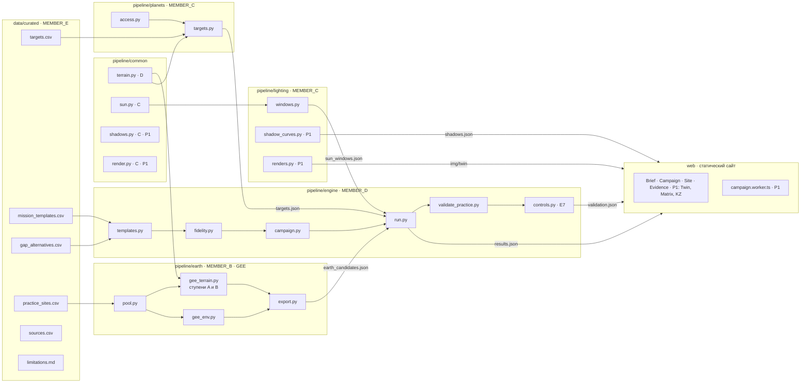

# Итоговая архитектура

Владелец: MEMBER_A. Статус: ACCEPTED в части принципов (DEC-011, DEC-022); точные версии библиотек фиксируются lock-файлами на INFRA-01. Реализация — с 14.11 09:00.

## 1. Варианты и выбор

| Вариант | Плюсы | Минусы | Решение |
| --- | --- | --- | --- |
| Только статические предрасчитанные данные | Надёжно, бесплатно, работает офлайн | Нет интерактивного пересчёта | Основа P0 |
| Вычисления в браузере (Web Worker) | Живой пересчёт кампании при смене задач, без сервера | Дублирование формул Python ↔ TS | P1, с golden-тестом |
| Пакетная обработка на Python | Точность, numpy и rasterio, воспроизводимость | Нужен запуск до сборки | Основа данных |
| Backend API (FastAPI и т. п.) | Гибкость | Хостинг, отказ на демо, лишняя работа | Отклонено |
| Serverless-функции | Без своего сервера | Холодный старт, лимиты, ключи | Отклонено |
| Гибрид: Python → JSON → статический сайт + Worker | Всё нужное без сервера | Два языка формул | **Выбрано** |

Почему без сервера: судьи открывают ссылку в разное время, интернет на площадке ненадёжен, бюджет нулевой. Объём данных (~3 тыс. кандидатов) помещается в браузер. Перебор кампании (≤ 280 тыс. наборов) укладывается в доли секунды.

## 2. Компоненты

Порядок сборки данных: `earth` (B) ‖ `planets` (C) ‖ `lighting.windows` (C) → `engine.run` (D) → `engine.validate_practice` и `engine.controls` (D) → (P1) `lighting.shadow_curves`, `lighting.renders` → `npm run build` (prebuild копирует `data/processed/*` в `web/public/data/`).

## 3. Слои и границы

| Слой | Где | Входы | Выходы | Владелец |
| --- | --- | --- | --- | --- |
| Курируемые данные | `data/curated/` | Литература, NASA | CSV, Markdown | E |
| Конвейер Земли | `pipeline/earth/` | GEE | `earth_candidates.json` | B |
| Цели | `pipeline/planets/` | PGDA, USGS | `targets.json` | C |
| Освещение | `pipeline/common/sun.py`, `pipeline/lighting/` | Широты, DEM 30 м | `sun_windows.json`, P1: `shadows.json`, картинки | C |
| Рельеф (общий) | `pipeline/common/terrain.py` | Массивы DEM | Атрибуты | D |
| Движок | `pipeline/engine/` | Все JSON + шаблоны | `results.json`, `validation.json`, `mission_templates.json` | D |
| Контракты | `contracts/`, `pipeline/contracts/`, `web/src/types/` | — | Схемы, валидатор, типы, фикстуры | A |
| Сайт | `web/` | `/data/*.json`, картинки | Статический бандл | A; панели — B, C, D; тексты — F |

**Правило границы:** модули общаются только через JSON-контракты (API_AND_SCHEMA_CONTRACTS) или через задокументированные функции `pipeline/common/*` (FUNCTION_SPECIFICATIONS). Импортировать внутренности чужого модуля нельзя.

## 4. Бюджеты производительности

| Что | Бюджет | Почему достижимо | Проверка |
| --- | --- | --- | --- |
| Данные сайта | ≤ 3 МБ gzip | ~3 тыс. кандидатов × ~20 чисел ≈ 1–1,5 МБ JSON; F_o 5 задач × 3 тыс. × 2 цели ≈ 0,5 МБ | `du`, DevTools |
| Первая отрисовка | ≤ 3 с на эмуляции Fast 4G | Статика, один бандл ≤ 500 КБ gzip без карты; MapLibre ≈ 250 КБ gzip | Lighthouse |
| Перекраска карты | ≤ 200 мс на 3 000 точек | Слой circle с feature-state | Профилирование |
| Пересчёт кампании (P1) | ≤ 300 мс, \|U\| ≤ 120, k = 3, 5 задач | 280 840 наборов × 5 сравнений ≈ 1,4 млн операций | Vitest-бенчмарк |
| `make data` без GEE | ≤ 5 мин на ноутбуке | numpy, окна ≤ 400×400 | Замер в INFRA-06 |
| Ступени GEE A и B | ≤ 60 мин суммарно в фоне | Группы по зонам UTM; getInfo порциями | Замер в EARTH-02; запасной путь — R04 |
| Память браузера | ≤ 300 МБ | Без растров, только точки и картинки | DevTools |

## 5. Надёжность и отказы

| Отказ | Обнаружение | Реакция |
| --- | --- | --- |
| Не загрузился JSON | `load.ts`: сетевая ошибка, неверная схема или версия | Экран ошибки с причиной и «Retry»; в офлайн-сборке данные локальные |
| Нет подложки GIBS | Событие ошибки тайла | Фон `--panel-2`, индикатор «Offline» |
| Worker завис или упал (P1) | Таймаут 2 с, onerror | Показать предрасчитанный результат и сообщение |
| GEE недоступен на хакатоне | EARTH-01 не стартует за 30 мин | Запасной путь R04: Copernicus на AWS для мест практики и коротких списков |
| DEM PGDA или MOLA/HRSC недоступен | PLNT-01 | Лестница: мозаика PGDA 20 м; MEGDR 463 м; CTX; литературные значения с пометкой |
| Несогласованные версии данных | Хэши входов в `results.json` против текущих файлов | `make check` падает; пересобрать данные |
| Синтетика в боевых данных | Валидатор: `synthetic: true` или `FAKE_` в `data/processed/` | `make check` падает |

## 6. Безопасность

- Ключей в клиенте нет. Учётные данные GEE только локально (`~/.config/earthengine`), `.env` в `.gitignore`.
- Входные данные пользователя — только выбор из списков и числа ползунков. Значения проверяются диапазонами (веса 0–3, k 1–3).
- Внешние данные: проверка схемой (jsonschema в Python, guard-функции в TS) и хэши в `provenance`.
- Зависимости: lock-файлы, `npm audit --omit=dev` и `pip-audit` (если доступен) в CI; без лишних пакетов.
- Лицензии сторонних материалов — в `submission/references.md`.
- Файлы: конвейер пишет только в `data/raw/`, `data/processed/`, `web/public/img/`; пути строятся из ID по белому списку символов `[A-Z0-9_]`.
- Деплой: статический хостинг, без переменных окружения с секретами; HTTPS по умолчанию.

## 7. Наблюдаемость

- Конвейер: структурированные логи (что, сколько, время), счётчики пропусков в `provenance`.
- Сайт: ноль ошибок консоли на основных сценариях (QA); версия данных и сборки в подвале.
- Реестр: `python3 tools/tasks.py status`; точки интеграции — INTEGRATION_STATUS.

## 8. Развёртывание

| Вариант | Как | Когда |
| --- | --- | --- |
| Vercel (основной) | `vercel.json`: `buildCommand: "npm --prefix web ci && npm --prefix web run build"`, `outputDirectory: "web/dist"`; превью для каждого PR | С INFRA-05 |
| GitHub Pages (запасной) | Workflow публикации `web/dist` | После публикации репозитория (SUB-05) |
| Офлайн | `npm --prefix web run build && npx serve web/dist`; архив на 2 ноутбуках и флешке | QA-03 |

## 9. Стек

| Слой | Выбор | Почему |
| --- | --- | --- |
| Данные Земли | Python 3.11+, earthengine-api | Наборы NASA и ESA в облаке, без скачивания |
| Планеты | rasterio (GDAL), pyproj, numpy | Окна, проекции с радиусом тела |
| Освещение | numpy; scipy.ndimage (поворот, P1); astropy — только в тестах | Свой алгоритм NOAA, эталон для проверки |
| Движок | numpy, pandas, jsonschema, scipy.stats | Простая прозрачная математика |
| Картинки | matplotlib, Pillow | Отмывка и тени |
| Тесты и качество | pytest, ruff; Vitest, `tsc --noEmit` | Привычно для ИИ-ассистентов |
| Сайт | Vite, React, TypeScript (strict), Zustand, MapLibre GL JS, SVG для графиков | Статика, строгие типы, открытая карта |
| Хостинг | Vercel; запасной — GitHub Pages | Превью на PR |

three.js — только для необязательной задачи WEB-12. Новые зависимости — через DECISIONS.md.
