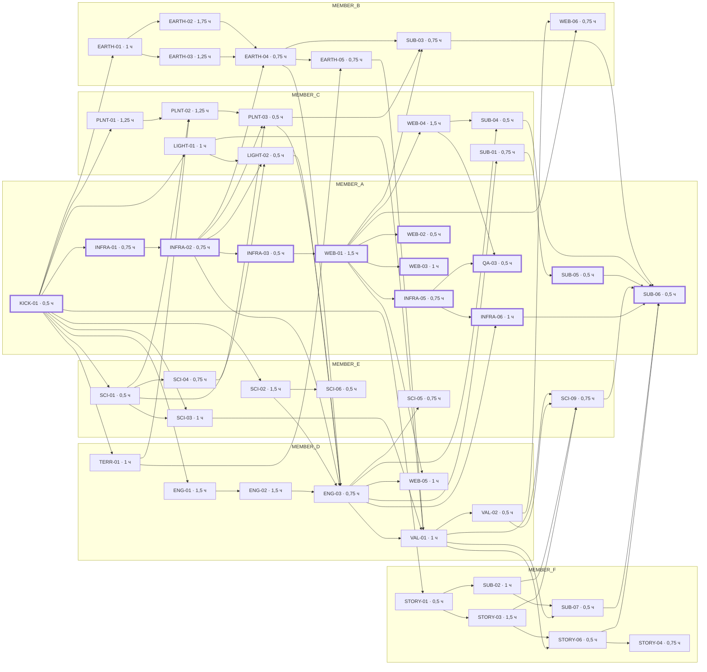

# Критический путь и зависимости

Владелец: MEMBER_A. Все таблицы и диаграмма между метками `BEGIN/END GENERATED` строятся из `project/tasks.json` командой `python3 tools/tasks.py render`; руками их не правим. Пересчитать модель расписания: `python3 tools/tasks.py schedule S1` (или `S1_STRICT`, `S2`, `S3`).

## 1. Два разных «критических пути»

| Что считаем | Как | Зачем нужно | Где |
| --- | --- | --- | --- |
| **Цепочка по зависимостям** | Самая длинная последовательность задач, где каждая ждёт результат предыдущей. Люди считаются бесконечно свободными | Показывает, какие передачи нельзя опоздать: задержка любого звена сдвигает всё дальше | §2 |
| **Цепочка с учётом занятости** | Модель: каждый участник делает свои задачи по очереди; задача стартует, когда готовы зависимости *и* свободен владелец. Время — по календарю сценария | Отвечает на вопрос «успеваем ли мы», потому что у одного человека задачи не идут параллельно | §3, §4 |

Главный вывод v2: **по зависимостям P0 — 7,5 ч, но с учётом занятости — 8,75 ч**. Узкое место — не одна передача, а последовательная нагрузка MEMBER_A (12 задач, 8,75 ч), и почти одновременно с ней — цепочка данных B → движок D → проверки D → тексты F и подпись E. Поэтому в плане: (1) MEMBER_A не берёт ничего сверх своих задач, а ревью чужих PR делают заместители (A↔D); (2) все передачи данных имеют «последний допустимый срок» (§6); (3) при отставании режем по CONTINGENCY_PLAN, а не «ускоряемся».

Оценки в реестре — **инженерное время**: написать, запустить, отладить, протестировать, отревьюить и слить. Это не время, за которое ИИ генерирует код: генерация занимает минуты, а проверка того, что код делает правильное на настоящих данных, — большую часть часа.

## 2. Цепочка по зависимостям

<!-- BEGIN GENERATED:critical-path -->
Самая длинная цепочка P0-задач хакатона **только по зависимостям**: **7,5 ч** работы подряд (без учёта занятости владельцев, ожидания и перерывов). Цепочка с учётом занятости — в модели сценариев ниже.

| # | ID | Задача | Владелец | Ч | Накопительно | Окно |
| --- | --- | --- | --- | --- | --- | --- |
| 1 | KICK-01 | Старт 09:00: решения и пререгистрация | MEMBER_A | 0,5 | 0,5 | Сб 09:00–09:30 |
| 2 | EARTH-01 | Пул кандидатов: страты, места практики | MEMBER_B | 1 | 1,5 | Сб 09:30–10:30 (повтор с PR_ ~11:15) |
| 3 | EARTH-02 | Атрибуты рельефа в GEE: ступени A и B | MEMBER_B | 1,75 | 3,25 | Сб 10:30–12:00 и 13:00–13:15 |
| 4 | EARTH-04 | Экспорт earth_candidates.json | MEMBER_B | 0,75 | 4 | Сб 14:30–15:15 |
| 5 | ENG-03 | run.py: results.json | MEMBER_D | 0,75 | 4,75 | Сб 15:15–16:00 |
| 6 | VAL-01 | Проверки: E3 с базовыми линиями и сводка E1, E2, E4 → validation.json | MEMBER_D | 1 | 5,75 | Сб 16:00–17:00 |
| 7 | VAL-02 | Отрицательные контроли E7 | MEMBER_D | 0,5 | 6,25 | Сб 17:00–17:30 |
| 8 | SCI-09 | Подпись реестра утверждений | MEMBER_E | 0,75 | 7 | Вс 11:00–11:45 |
| 9 | SUB-06 | Финальная подача | MEMBER_A | 0,5 | 7,5 | Вс 13:00–13:30 или до 21:00 (по ответу PREP-01) |

С учётом P1-задач самая длинная цепочка по зависимостям — 10,75 ч: KICK-01 → EARTH-01 → EARTH-02 → EARTH-04 → ENG-03 → EARTH-08 → LIGHT-03 → LIGHT-04 → WEB-07.
<!-- END GENERATED:critical-path -->

## 3. Сценарии: успеваем ли мы

Сценарии и их календари записаны в `meta.scenarios` реестра. Почему календари такие — [EXISTING_PLAN_CRITICAL_REVIEW §1](../audit/EXISTING_PLAN_CRITICAL_REVIEW.md); какой сценарий действует — решается по ответам организаторов на вопросы 4 и 5 (PREP-01) и записывается в DECISIONS.md (DEC-024).

<!-- BEGIN GENERATED:scenarios -->
Модель (`python3 tools/tasks.py schedule`): каждый участник выполняет свои задачи по очереди; задача начинается, когда готовы её зависимости и свободен владелец; из готовых — по одному из трёх правил (самая длинная оставшаяся цепочка, больше зависящих задач, порядок ID); P1 занимает только свободные окна участника и не сдвигает P0; берётся лучший вариант (раньше конец P0, затем больше P1). Перерывы и ночь — по календарю сценария. «100 %» — оценки как записаны; «75 %» — с поправкой на синхронизацию, слияния и отладку. Перекрытие ожидания расчётов GEE с другой работой и время соисполнителей на встречах не моделируются. Это проверка выполнимости, а не расписание (плановые окна — в HOUR_BY_HOUR_EXECUTION).

| Сценарий | Рабочее время (Астана) | Объём | Работа по модели, ч | P0 готово при 100 % | P0 готово при 75 % | Вывод |
| --- | --- | --- | --- | --- | --- | --- |
| **S1** — площадка; работа и во время брифинга (кроме слушателя) | Сб 09:00–12:00, 13:00–18:00; Вс 09:00–13:30 (12,5 ч) | P0: 47 задач, 40,75 ч | 8,75 | Вс 09:45 | Вс 12:40 | помещается; запас 0,83 ч по часам |
| **S1_STRICT** — только официальные блоки работы | Сб 13:00–18:00; Вс 09:00–13:30 (9,5 ч) | P0: 47 задач, 40,75 ч | 8,75 | Вс 12:45 | после конца (+2,17 ч) | только при 100 %; при 75 % не хватает 2,17 ч |
| **S2** — плюс вечер субботы и раннее утро воскресенья | Сб 09:00–12:00, 13:00–18:00, 19:30–23:00; Вс 08:00–13:30 (17 ч) | P0: 47 задач, 40,75 ч; P1: 22 задачи, успевают 18 | 8,75 | Сб 20:15 | Вс 08:10 | помещается; запас 5,33 ч по часам |
| **S3** — аварийный объём на календаре S1-строгий (CONTINGENCY_PLAN §3) | Сб 13:00–18:00; Вс 09:00–13:30 (9,5 ч) | P0: 41 задача, 30,5 ч; без VAL-02, WEB-02, WEB-05, WEB-06, QA-03, STORY-04; урезано: PLNT-01, PLNT-02, SCI-01, SCI-04, EARTH-02, EARTH-03, ENG-02, VAL-01, WEB-03, WEB-04, INFRA-05, INFRA-06, SCI-09, STORY-03, SUB-02, SUB-04 | 7,25 | Вс 11:15 | после конца (+0,17 ч) | только при 100 %; при 75 % не хватает 0,17 ч |

- Цепочка, определяющая конец P0 в S1: KICK-01 (A) → INFRA-01 (A) → INFRA-02 (A) → INFRA-03 (A) → WEB-01 (A) → INFRA-05 (A) → WEB-03 (A) → WEB-02 (A) → INFRA-06 (A) → SUB-05 (A) → QA-03 (A) → SUB-06 (A).
- Цепочка, определяющая конец P0 в S1_STRICT: KICK-01 (A) → INFRA-01 (A) → INFRA-02 (A) → INFRA-03 (A) → WEB-01 (A) → INFRA-05 (A) → WEB-03 (A) → WEB-02 (A) → INFRA-06 (A) → SUB-05 (A) → QA-03 (A) → SUB-06 (A).
- Цепочка, определяющая конец P0 в S2: KICK-01 (A) → INFRA-01 (A) → INFRA-02 (A) → INFRA-03 (A) → WEB-01 (A) → INFRA-05 (A) → WEB-03 (A) → WEB-02 (A) → INFRA-06 (A) → SUB-05 (A) → QA-03 (A) → SUB-06 (A).
- Цепочка, определяющая конец P0 в S3: KICK-01 (A) → PLNT-01 (C) → LIGHT-01 (C) → PLNT-02 (C) → PLNT-03 (C) → LIGHT-02 (C) → ENG-03 (D) → VAL-01 (D) → STORY-06 (F) → SUB-07 (F) → SUB-06 (A).
<!-- END GENERATED:scenarios -->

Как читать: «помещается» — весь P0 закончен до подачи в Вс 13:30 при выбранной продуктивности. Модель оптимистична в одном (люди не болеют, задачи не переделываются) и пессимистична в другом (не учитывает, что B может писать код, пока GEE считает). Поэтому решения принимаются по **фактическим** воротам (CONTINGENCY_PLAN §2), а модель нужна, чтобы заранее знать, где тонко.

## 4. Модельное расписание S1

<!-- BEGIN GENERATED:schedule:S1 -->
Сценарий S1 (Сб 09:00–12:00, 13:00–18:00; Вс 09:00–13:30). Время работы считается от начала календаря; «Ждёт» — что определило старт (зависимость или предыдущая задача владельца).

| Старт, ч | Финиш, ч | ID | Задача | Владелец | Ч | Ждёт | Готово при 100 % | Готово при 75 % |
| --- | --- | --- | --- | --- | --- | --- | --- | --- |
| 0 | 0,5 | KICK-01 | Старт 09:00: решения и пререгистрация | A | 0,5 | — | Сб 09:30 | Сб 09:40 |
| 0,5 | 1,5 | EARTH-01 | Пул кандидатов: страты, места практики | B | 1 | KICK-01 | Сб 10:30 | Сб 11:00 |
| 0,5 | 2 | ENG-01 | fidelity.py и templates.py | D | 1,5 | KICK-01 | Сб 11:00 | Сб 11:40 |
| 0,5 | 1,25 | INFRA-01 | Каркас репозитория | A | 0,75 | KICK-01 | Сб 10:15 | Сб 10:40 |
| 0,5 | 1,75 | PLNT-01 | Спайк доступа к DEM целей и решение | C | 1,25 | KICK-01 | Сб 10:45 | Сб 11:20 |
| 0,5 | 1 | SCI-01 | targets.csv: цели и координаты | E | 0,5 | KICK-01 | Сб 10:00 | Сб 10:20 |
| 0,5 | 1 | STORY-01 | Название, слоган, ценностное предложение | F | 0,5 | KICK-01 | Сб 10:00 | Сб 10:20 |
| 1 | 2,5 | SCI-02 | mission_templates.csv и gap_alternatives.csv | E | 1,5 | SCI-01 | Сб 11:30 | Сб 13:20 |
| 1 | 2,5 | STORY-03 | Слайды: структура и черновик | F | 1,5 | STORY-01 | Сб 11:30 | Сб 13:20 |
| 1,25 | 2 | INFRA-02 | Контракты v1: схемы, валидатор, типы | A | 0,75 | INFRA-01 | Сб 11:00 | Сб 11:40 |
| 1,5 | 3,25 | EARTH-02 | Атрибуты рельефа в GEE: ступени A и B | B | 1,75 | EARTH-01 | Сб 13:15 | Сб 14:20 |
| 1,75 | 2,75 | LIGHT-01 | sun.py: положение Солнца, окна низкого Солнца, проверка E1 | C | 1 | PLNT-01 | Сб 11:45 | Сб 13:40 |
| 2 | 2,5 | INFRA-03 | Синтетические фикстуры | A | 0,5 | INFRA-02 | Сб 11:30 | Сб 13:20 |
| 2 | 3 | TERR-01 | terrain.py: атрибуты рельефа на базах | D | 1 | ENG-01 | Сб 12:00 | Сб 14:00 |
| 2,5 | 3,25 | SCI-04 | Курируемые значения целей | E | 0,75 | SCI-02 | Сб 13:15 | Сб 14:20 |
| 2,5 | 3,5 | SUB-02 | Страница проекта: черновик | F | 1 | STORY-03 | Сб 13:30 | Сб 14:40 |
| 2,5 | 4 | WEB-01 | Каркас приложения: маршруты, загрузка, store, токены | A | 1,5 | INFRA-03 | Сб 14:00 | Сб 15:20 |
| 2,75 | 3,25 | LIGHT-02 | sun_windows.json по широтным полосам | C | 0,5 | LIGHT-01 | Сб 13:15 | Сб 14:20 |
| 3 | 4,5 | ENG-02 | campaign.py: короткий список, точный перебор, жадный поиск, разрывы | D | 1,5 | TERR-01 | Сб 14:30 | Сб 16:00 |
| 3,25 | 4,5 | EARTH-03 | Атрибуты среды в GEE | B | 1,25 | EARTH-02 | Сб 14:30 | Сб 16:00 |
| 3,25 | 4,5 | PLNT-02 | Атрибуты целей на базах NASA | C | 1,25 | LIGHT-02 | Сб 14:30 | Сб 16:00 |
| 3,25 | 4,25 | SCI-03 | practice_sites.csv из заметок PREP-15, пререгистрированно | E | 1 | SCI-04 | Сб 14:15 | Сб 15:40 |
| 4 | 4,75 | INFRA-05 | Деплой и офлайн-сборка | A | 0,75 | WEB-01 | Сб 14:45 | Сб 16:20 |
| 4,25 | 4,75 | SCI-06 | limitations.md | E | 0,5 | SCI-03 | Сб 14:45 | Сб 16:20 |
| 4,5 | 5,25 | EARTH-04 | Экспорт earth_candidates.json | B | 0,75 | EARTH-03 | Сб 15:15 | Сб 17:00 |
| 4,5 | 5 | PLNT-03 | targets.json | C | 0,5 | PLNT-02 | Сб 15:00 | Сб 16:40 |
| 4,75 | 5,75 | WEB-03 | Карта Земли | A | 1 | INFRA-05 | Сб 15:45 | Сб 17:40 |
| 5 | 6,5 | WEB-04 | Панели кампании: задачи, фронт, карточка, разрывы | C | 1,5 | PLNT-03 | Сб 16:30 | Вс 09:40 |
| 5,25 | 6 | EARTH-05 | Сверка GEE с terrain.py (E2b) и проверки здравого смысла | B | 0,75 | EARTH-04 | Сб 16:00 | Сб 18:00 |
| 5,25 | 6 | ENG-03 | run.py: results.json | D | 0,75 | EARTH-04 | Сб 16:00 | Сб 18:00 |
| 5,75 | 6,25 | WEB-02 | Экран Mission Brief | A | 0,5 | WEB-03 | Сб 16:15 | Вс 09:20 |
| 6 | 6,75 | SCI-05 | Научная проверка кампаний и кандидатов | E | 0,75 | ENG-03 | Сб 16:45 | Вс 10:00 |
| 6 | 6,75 | SUB-03 | Реестр источников и лицензий | B | 0,75 | EARTH-05 | Сб 16:45 | Вс 10:00 |
| 6 | 7 | VAL-01 | Проверки: E3 с базовыми линиями и сводка E1, E2, E4 → validation.json | D | 1 | ENG-03 | Сб 17:00 | Вс 10:20 |
| 6,25 | 7,25 | INFRA-06 | Точки интеграции IC-1, IC-2, IC-3, снимок данных и релиз | A | 1 | WEB-02 | Сб 17:15 | Вс 10:40 |
| 6,5 | 7,25 | SUB-01 | README для жюри | C | 0,75 | WEB-04 | Сб 17:15 | Вс 10:40 |
| 7 | 7,5 | STORY-06 | Слайды: числа и экспорт | F | 0,5 | VAL-01 | Сб 17:30 | Вс 11:00 |
| 7 | 7,5 | VAL-02 | Отрицательные контроли E7 | D | 0,5 | VAL-01 | Сб 17:30 | Вс 11:00 |
| 7,25 | 7,75 | SUB-04 | Раскрытие использования ИИ | C | 0,5 | SUB-01 | Сб 17:45 | Вс 11:20 |
| 7,25 | 7,75 | SUB-05 | Приватность и публикация репозитория | A | 0,5 | INFRA-06 | Сб 17:45 | Вс 11:20 |
| 7,5 | 8,25 | SCI-09 | Подпись реестра утверждений | E | 0,75 | VAL-02 | Вс 09:15 | Вс 12:00 |
| 7,5 | 8 | SUB-07 | Страница проекта: числа и перенос на сайт | F | 0,5 | STORY-06 | Сб 18:00 | Вс 11:40 |
| 7,5 | 8,5 | WEB-05 | Панель площадки | D | 1 | VAL-02 | Вс 09:30 | Вс 12:20 |
| 7,5 | 8,25 | WEB-06 | Страница Evidence | B | 0,75 | VAL-02 | Вс 09:15 | Вс 12:00 |
| 7,75 | 8,25 | QA-03 | Офлайн-комплект для питча | A | 0,5 | SUB-05 | Вс 09:15 | Вс 12:00 |
| 8 | 8,75 | STORY-04 | Репетиция питча | F | 0,75 | SUB-07 | Вс 09:45 | Вс 12:40 |
| 8,25 | 8,75 | SUB-06 | Финальная подача | A | 0,5 | QA-03 | Вс 09:45 | Вс 12:40 |
<!-- END GENERATED:schedule:S1 -->

Модель ставит задачи «как можно раньше». Плановые окна в реестре и в [HOUR_BY_HOUR_EXECUTION](HOUR_BY_HOUR_EXECUTION.md) для некоторых задач позже (например, README, подпись утверждений и публикация — после заморозки данных в Вс 11:00), потому что так меньше переделок. Если плановое окно задачи раньше модельного старта — это сигнал, что окно нереалистично; такие расхождения исправляются в реестре.

## 5. Граф зависимостей P0

Узлы — задачи P0 хакатона по участникам; стрелка — «нужен результат». Толстая рамка — цепочка, которая определяет конец P0 в модели S1.

<!-- BEGIN GENERATED:dependency-graph -->

<!-- END GENERATED:dependency-graph -->

## 6. Передачи между участниками: план и последний допустимый срок

«Последний срок» — позже него ворота CONTINGENCY_PLAN включают запасной путь автоматически, без обсуждения.

| Артефакт | От → кому | План (S1) | Последний срок | Если не готово |
| --- | --- | --- | --- | --- |
| Коммит пререгистрации (KICK-01) | A → все | Сб 09:30 | До первого запуска VAL-01 | VAL-01 не запускается: без пререгистрации E3 не публикуем |
| `data/curated/targets.csv` (SCI-01) | E → C | Сб 10:00 | Сб 11:30 | C берёт центр участка PGDA 20 и Jezero из DATASET_SPECIFICATION |
| Сигнатура `terrain_attributes` (TERR-01) | D → C, B | Сб 10:30 | Сб 13:00 | C считает атрибуты целей по формулам спецификации сам, D сверяет позже |
| Контракты v1 (INFRA-02) | A → все | Сб 11:00 | Сб 11:30 | Поля, о которых спорят, — необязательные; решает A |
| Фикстуры (INFRA-03) | A → A, C, D | Сб 11:30 | Сб 13:00 | Сайт и движок берут примеры из `contracts/examples/` |
| `practice_sites.csv` (SCI-03) | E → B, D | Сб 11:00 | До первого запуска VAL-01 (git log) | Пары, добавленные после запуска, в E3 не входят |
| Решение по данным целей (PLNT-01) | C → все | Сб 10:45 | Сб 13:30 | Лестница данных: мозаика PGDA 20 м / MEGDR 463 м |
| `mission_templates.csv` (SCI-02) | E → D | Сб 13:30 | Сб 15:00 | Стартовые веса MATHEMATICAL_SPECIFICATION §7.3 |
| `sun_windows.json` (LIGHT-02) | C → D | Сб 14:30 | Сб 15:30 | Задача O4 считается без атрибута light (пометка «not assessed») |
| `earth_candidates.json` (EARTH-04) | B → D, C | Сб 15:15 | Сб 16:00 | Срез на кандидатах со ступенью A; ступень B — пометка proxy |
| `targets.json` (PLNT-03) | C → D | Сб 15:00 | Сб 16:00 | Одна цель (Mons Mouton) для IC-1, Jezero — следующим запуском |
| `results.json` (ENG-03) | D → A, C, E, B | Сб 16:00 | Сб 17:30 (IC-1) | IC-1 на одной цели; без results.json нет кампании — S3 |
| `validation.json` (VAL-01, VAL-02) | D → B, E, F, C | Сб 17:00 / 17:30 | Вс 10:00 | Слайды и страница — без чисел проверки; утверждение C3 снимается |
| Подписанный `submission/claims.md` (SCI-09) | E → F, A | Вс 11:45 | Вс 12:30 | Подача только с утверждениями, которые E успел подписать; остальные удаляются |

## 7. Матрица зависимостей между участниками

<!-- BEGIN GENERATED:dependency-matrix -->
Строка — кто ждёт, столбец — от кого. В ячейке число межличностных зависимостей.

| ждёт \ от кого | A | B | C | D | E | F |
| --- | --- | --- | --- | --- | --- | --- |
| **A** | · | 2 | 5 | 1 | 1 | 5 |
| **B** | 5 | · | 1 | 3 |  |  |
| **C** | 5 | 1 | · | 3 | 3 | 1 |
| **D** | 5 | 2 | 4 | · | 2 |  |
| **E** | 3 |  |  | 5 | · | 2 |
| **F** | 3 |  | 1 | 2 |  | · |

Подробно (производитель → потребитель):

- MEMBER_A → MEMBER_B: INFRA-02→EARTH-04, KICK-01→EARTH-01, PREP-04→PREP-05, WEB-01→SUB-03, WEB-01→WEB-06
- MEMBER_A → MEMBER_C: INFRA-02→LIGHT-02, INFRA-02→PLNT-03, KICK-01→LIGHT-01, KICK-01→PLNT-01, WEB-01→WEB-04
- MEMBER_A → MEMBER_D: INFRA-02→ENG-03, KICK-01→ENG-01, KICK-01→TERR-01, WEB-01→ENG-05, WEB-01→WEB-05
- MEMBER_A → MEMBER_E: KICK-01→SCI-01, KICK-01→SCI-02, KICK-01→SCI-03
- MEMBER_A → MEMBER_F: KICK-01→STORY-01, RULE-01→RULE-02, WEB-01→STORY-02
- MEMBER_B → MEMBER_A: EARTH-07→WEB-10, SUB-03→SUB-06
- MEMBER_B → MEMBER_C: EARTH-08→LIGHT-03
- MEMBER_B → MEMBER_D: EARTH-04→ENG-03, EARTH-05→VAL-01
- MEMBER_C → MEMBER_A: LIGHT-04→WEB-07, SUB-01→SUB-05, SUB-04→SUB-06, WEB-04→QA-03, WEB-04→WEB-11
- MEMBER_C → MEMBER_B: PLNT-03→SUB-03
- MEMBER_C → MEMBER_D: LIGHT-01→VAL-01, LIGHT-02→ENG-03, PLNT-03→ENG-03, WEB-04→WEB-09
- MEMBER_C → MEMBER_F: WEB-04→STORY-05
- MEMBER_D → MEMBER_A: ENG-03→INFRA-06
- MEMBER_D → MEMBER_B: ENG-03→EARTH-08, TERR-01→EARTH-05, VAL-02→WEB-06
- MEMBER_D → MEMBER_C: ENG-03→SUB-01, ENG-03→SUB-04, TERR-01→PLNT-02
- MEMBER_D → MEMBER_E: ENG-03→SCI-05, ENG-03→SCI-07, VAL-01→SCI-09, VAL-01→SCI-10, VAL-02→SCI-09
- MEMBER_D → MEMBER_F: VAL-01→STORY-06, VAL-01→SUB-07
- MEMBER_E → MEMBER_A: SCI-09→SUB-06
- MEMBER_E → MEMBER_C: SCI-01→LIGHT-02, SCI-01→PLNT-02, SCI-04→PLNT-03
- MEMBER_E → MEMBER_D: SCI-02→ENG-03, SCI-03→VAL-01
- MEMBER_F → MEMBER_A: PREP-01→AUTH-02, PREP-02→RULE-04, RULE-03→RULE-04, STORY-06→SUB-06, SUB-07→SUB-06
- MEMBER_F → MEMBER_C: PREP-01→AUTH-01
- MEMBER_F → MEMBER_E: STORY-03→SCI-09, SUB-02→SCI-09
<!-- END GENERATED:dependency-matrix -->

## 8. Нагрузка

<!-- BEGIN GENERATED:workload -->
| Участник | Роль | Задач | До 14.11, ч | Хакатон P0, ч | Хакатон P1, ч | P0+P1, ч | P2–P3, ч |
| --- | --- | --- | --- | --- | --- | --- | --- |
| MEMBER_A | Тех-лид: контракты, каркас сайта, карта, Brief, «То же Солнце», деплой, интеграция, публикация и подача | 25 | 11,5 | 8,75 | 4 | 12,75 | 2 |
| MEMBER_B | Земля: пул кандидатов и атрибуты в Earth Engine; страница Evidence; реестр источников | 12 | 3 | 7 | 3 | 10 | 0,5 |
| MEMBER_C | Луна и Марс, освещение: цели, Солнце, тени; панель кампании; README для жюри | 17 | 6 | 7,25 | 5,25 | 12,5 | 2,5 |
| MEMBER_D | Движок: рельеф, соответствие, оптимизатор кампании, проверки; панель площадки | 14 | 3 | 7,25 | 5 | 12,25 | 0 |
| MEMBER_E | Геолог: цели, шаблоны задач, практика NASA, разрывы, научная подпись | 12 | 6 | 5,75 | 3,25 | 9 | 0 |
| MEMBER_F | Продукт и питч: название, слайды, тексты страницы проекта, видео, питч, связь с организаторами | 14 | 5,5 | 4,75 | 3 | 7,75 | 0 |
| **Итого** | | 94 | 35 | 40,75 | 23,5 | 64,25 | 5 |
<!-- END GENERATED:workload -->

Часы соисполнителей (встречи KICK-01, IC-1…IC-3, репетиция — около 2,25 ч на человека) в таблицу не входят; их покрывает поправка 0,75 к продуктивности.
